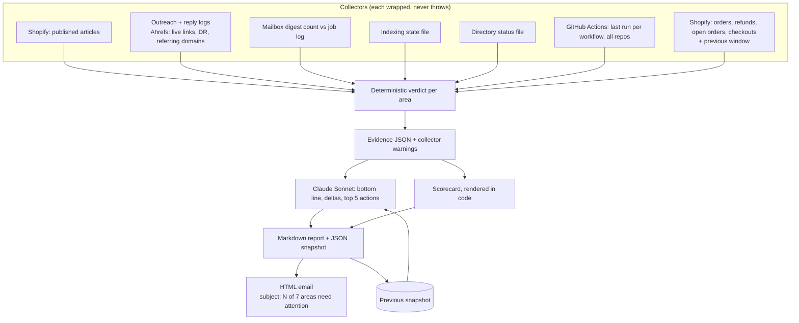

# Outcome Health Check: did each automation achieve its goal, or did it only exit cleanly?

A twice-monthly audit of a whole automation suite. It ignores what each job says about itself and goes to the source: the store, the search data, the mailbox, the workflow history and the state files. Each area gets one of four verdicts, the result is compared with the last check, and Claude writes a short narrative with five actions ranked by impact.

## The problem

A green checkmark means a script ran without throwing. It does not mean the script did anything. Automations fail quietly in ways a status monitor never sees:

- A publishing job that runs daily and publishes nothing, because its queue is empty.
- An inbox monitor that runs four times a day and reads zero emails, because a mail filter changed where they land.
- An outreach job that sends pitches every day and has not produced a single live link.
- A workflow that has not run in five weeks because its schedule was silently disabled.

Each of these shows up as success in the Actions tab. The only way to catch them is to check outcomes against ground truth.

## What it does

`src/outcome-health-check.js` audits seven areas over a rolling window (15 days by default):

| Area | Ground truth | What "achieving" means |
|---|---|---|
| Content pipeline | Articles actually published on the store | Publishing rate near the target |
| Partner outreach | Outreach and reply logs, plus Ahrefs for live backlinks from the sites that received an article | At least one confirmed live link |
| Journalist requests | Digests that arrived in the mailbox vs digests the job saw vs pitches sent | Pitches went out. Flags "deaf" when digests arrive but the job sees none |
| Indexing | The indexing job's state file | A scan in the last three days |
| Directory listings | The directory job's status file | At least one live listing |
| Workflows | Last completed run of every workflow in every audited repo | No failed last runs. Lists scheduled workflows silent for more than 35 days |
| Business vitals | Shopify orders, refunds, open unfulfilled orders, fraud-review tags, abandoned checkouts, and the previous window for comparison | No orders held for fraud review, refund rate under 10%, revenue not down more than 30% |

Verdicts are `ACHIEVING`, `RUNNING-NOT-ACHIEVING`, `NOT-RUNNING`, `DORMANT`, or `NOT AUDITABLE` when a source could not be read.

## Architecture



## Key design decisions

**Verdicts are computed in code, not by the model.** Each area's verdict comes from explicit thresholds on the evidence. The model never decides whether something is working. It only writes the narrative on top of verdicts that are already fixed, and the scorecard is rendered separately from its output.

**A broken source becomes a row, not a crash.** Every collector is wrapped. A missing secret, a dead API or an absent state file produces a `NOT AUDITABLE` verdict with the reason, and the rest of the report still builds. Running it with no credentials at all still produces a complete report.

**Self-reported success is checked against an independent count.** For the journalist monitor, the audit counts digests in the mailbox itself and compares that with how many the job logged seeing. A mismatch is reported as the job being deaf.

**Outreach is judged by links, not by sends.** The audit asks Ahrefs whether each site that received an article now links back. Sending is activity. A live link is the outcome.

**Revenue comes first.** The narrative prompt requires that abnormal sales, order counts or an unfulfilled backlog lead the summary, ahead of any search metric. The business check also pulls the previous window of the same length, so a revenue drop is visible on the very first run.

**Stale is defined carefully.** A workflow counts as silent only if it has a schedule. Manual-only tools are expected to sit idle and are excluded.

**Every run leaves a snapshot.** The evidence is saved as JSON alongside the markdown report, and the next run reads it to show what moved.

## Repository layout

```
src/outcome-health-check.js  collectors, verdicts, narrative, scorecard, report, email
.github/workflows/           run on the 1st and 15th, snapshot carried in the Actions cache
```

## Setup

Requires Node 20+. Every source is optional: leave one out and its area reports as not auditable.

```bash
npm install
npm run check:no-email        # builds reports/health-checks/<date>.md with whatever is configured
cp .env.example .env          # add sources one at a time
npm run check
```

| Variable | Purpose |
|---|---|
| `SHOPIFY_STORE`, `SHOPIFY_ADMIN_TOKEN` | Published articles and business vitals |
| `AHREFS_API_TOKEN` | Live-link checks, domain rating, referring domains |
| `GMAIL_USER`, `GMAIL_APP_PASSWORD`, `EMAIL_NOTIFY` | Counting digests in the mailbox and sending the report |
| `GITHUB_TOKEN`, `MONITOR_REPO`, `EXTRA_REPOS`, `EXTRA_REPOS_TOKEN` | Workflow run history for one or more repos |
| `ANTHROPIC_API_KEY` | The narrative. Without it the scorecard still renders |
| `COMPANY_NAME`, `SITE_DOMAIN`, `BUSINESS_DESCRIPTION`, `NARRATIVE_RULES` | Identity and rules for the narrative |
| `WINDOW_DAYS`, `ARTICLES_PER_DAY_TARGET`, `FRAUD_REVIEW_TAG_PATTERN`, `MANUAL_ONLY_PATTERN` | Thresholds and patterns |
| `STATE_DIR` | Folder holding the other automations' state files |

Reports contain business figures, so `reports/` is gitignored and the snapshot travels in the Actions cache.

Scheduled runs are off by default. Set the repository variable `ENABLE_SCHEDULE` to `true` to turn the schedule on; manual runs from the Actions tab always work.

---

Extracted from a production automation suite I built and ran for a live e-commerce and B2B wholesale business, 2026.

© Michael Wootan. Source shared for portfolio review; all rights reserved.
